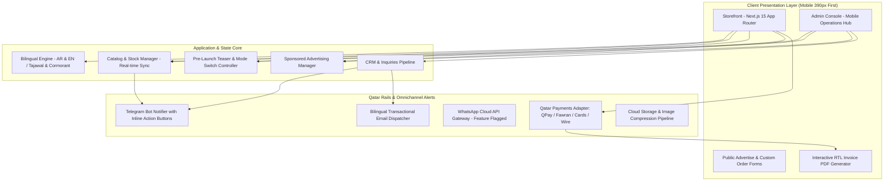
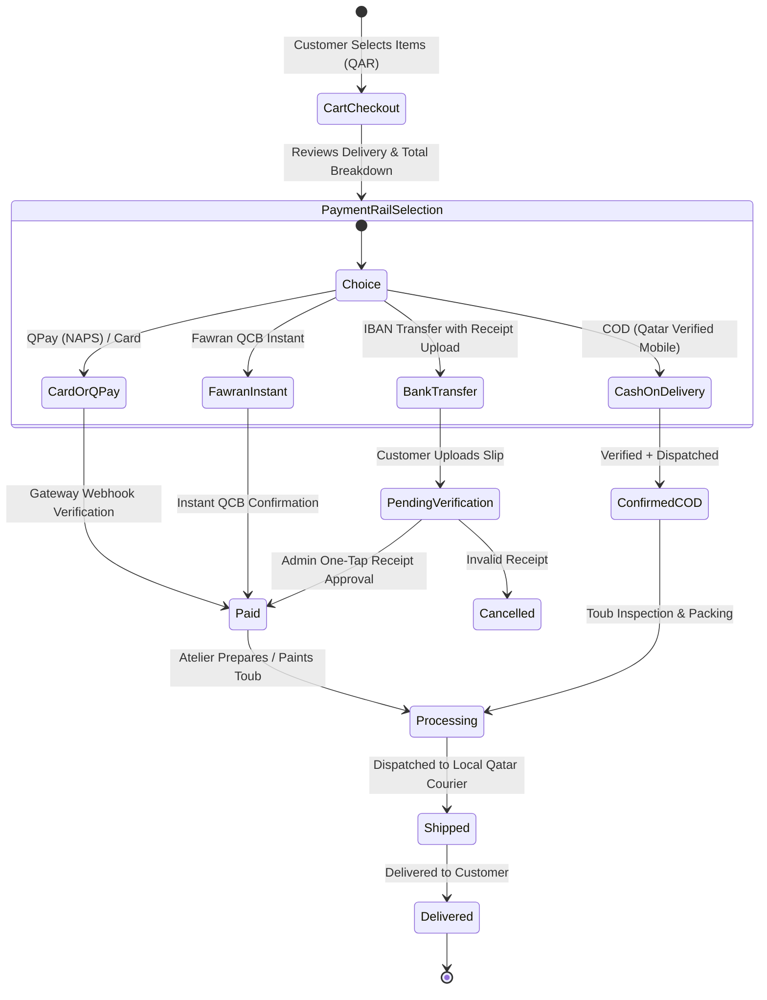
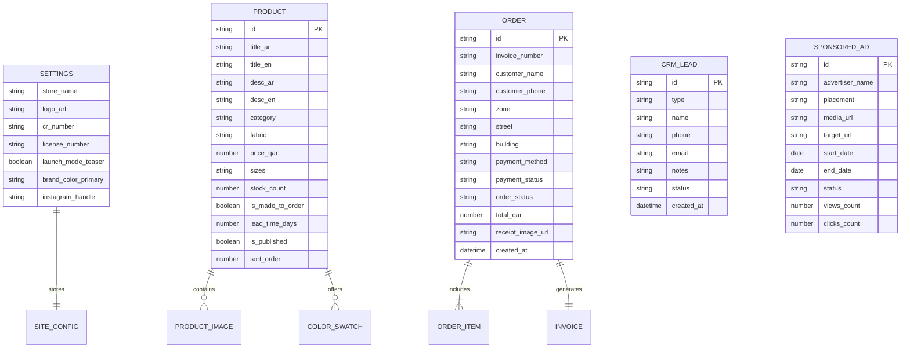

# BURGUNDY - Architecture & System Design

## 1. System Overview & Technology Stack
BURGUNDY is a mobile-first, high-performance luxury e-commerce platform custom-engineered for hand-painted Sudanese women's wear operating under State of Qatar e-commerce regulations.

## 2. Order & Payment State Machine

## 3. Entity-Relationship Data Model

## 4. Telegram & Omnichannel Flow
When a customer places an order or submits a custom order/advertise lead, the backend dispatches a webhook to the Telegram bot with inline keyboard buttons:
- `[✅ Confirm / Ship]`
- `[📄 View Invoice]`
- `[📞 Contact Customer via WhatsApp]`
Allowing the store owner to run operations directly from their phone with zero latency.
